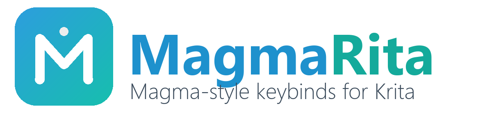

# MagmaRita

Magma-style keyboard shortcuts for **Krita** - so artists coming from
[Magma](https://magma.com) feel at home in seconds.

> Unofficial community project. Not affiliated with Magma or the Krita team.

## The idea

Magma uses a fast, muscle-memory keymap: single letters for tools, digits for
**tool presets** (1..6), "[" / "]" for brush size, "=" / "-" for zoom.
Krita can do all of it, but the keys are different. MagmaRita closes that gap:

- a ready-made **keymap** (Krita shortcut overrides) that mirrors Magma,
- a **tool-preset strip** on the number keys via Krita's built-in *Ten Brushes* plugin,
- a small **PyKrita plugin** (Tools > Scripts > MagmaRita) with one-click apply / restore.

## Keymap

| Key | Magma | In Krita (via MagmaRita) |
|-----|-------|--------------------------|
| 1 | tool preset 1 (dropper) | Dropper / colour sampler |
| 2 | tool preset 2 | Small eraser |
| 3 | tool preset 3 | Pen *(Ten Brushes)* |
| 4 | tool preset 4 | Basic brush *(Ten Brushes)* |
| 5 | tool preset 5 | Soft eraser *(Ten Brushes)* |
| 6 | tool preset 6 | Big eraser *(Ten Brushes)* |
| I | eyedropper | Colour sampler |
| B | brush | Freehand brush |
| E | eraser | Toggle erase mode |
| G | paint bucket | Fill |
| U | rectangle | Rectangle |
| M / L | selection / lasso | Rectangle select / Polygonal select |
| V | move | Move |
| Shift+T | transform | Transform |
| C | - | Crop |
| Z | zoom (hold + drag) | Scrubby Zoom *(bundled plugin)* |
| R | rotate canvas around the centre (hold + drag) | Scrubby Rotate *(bundled plugin)* |
| Ctrl | straight line (hold Ctrl, drag, release) | Line tool (line assist) |
| = / - | zoom in / out | Zoom in / out |
| Home / End | fit / actual pixels | Fit to page / 100% |
| H | flip horizontally | Mirror canvas |
| X | switch colours | Toggle foreground/background |
| [ / ] | brush size | Brush size |
| Tab | toggle UI | Canvas-only mode |
| Ctrl+D | deselect | Deselect |
| Ctrl+A | select all | Select all |
| Ctrl+Z / Ctrl+Shift+Z | undo / redo | Undo / redo |
| Shift+N | add layer | Add paint layer |
| Ctrl+E / Ctrl+J | merge / copy | Merge down / Duplicate layer |
| F6 | - | Brush presets docker |

Full details in [docs/KEYMAP.md](docs/KEYMAP.md).

## Install

**1. Close Krita** (Krita rewrites its config on exit).

**2. Run the installer for your OS.**

Windows:

~~~
install.bat
~~~

Linux / macOS:

~~~
./install.sh
~~~

Or manually:

~~~
python install.py
~~~

**3. Start Krita.** That's it.

Optionally enable the plugin UI: *Settings > Configure Krita > Python Plugin
Manager > MagmaRita* (adds *Tools > Scripts > MagmaRita*).

## Uninstall

~~~
python uninstall.py
~~~

This removes the plugin and restores the newest "*.bak-magmarita-*" backups
that the installer created next to "kritarc" / "kritashortcutsrc".

## How it works

Krita keeps its keyboard overrides in "kritashortcutsrc" (only the keys you
changed) and plugin/settings in "kritarc". MagmaRita merges a small override
set into those files and enables the bundled **Ten Brushes** plugin with
Magma-ish preset slots (slot 2 = small eraser, 3 = pen, ...).

Config locations:

| OS | config | resources |
|----|--------|-----------|
| Windows | %LOCALAPPDATA% | %APPDATA%\krita |
| Linux | ~/.config | ~/.local/share/krita |
| macOS | ~/Library/Preferences | ~/Library/Application Support/krita |

## Requirements

- Krita **5.2+** (tested on 5.3.4, Windows)
- Python 3 (bundled with Krita; only needed for the installer script)

## Repo layout

~~~
pykrita/magmarita/   PyKrita plugin (keymap.py is the source of truth)
pykrita/magmarita_scrubby_zoom/  bundled, fixed Scrubby Zoom plugin
shortcuts/           MagmaRita.shortcuts - importable Krita shortcut scheme
tools/build_scheme.py regenerates the scheme from a Krita install
install.py/.bat/.sh  installer
uninstall.py         uninstaller
docs/KEYMAP.md       full keymap reference
~~~

## Palette (Magma-style panel)

Enable the docker: **Settings > Dockers > MagmaRita** (or right-click a docker
area and pick it). It gives you a compact panel:

* quick **tool buttons** - Dropper, Brush, Erase, Fill, Rect, Select, Lasso,
  Move, Transform, Crop;
* the ten **brush-preset slots** with thumbnails - **click to activate**,
  **right-click** to assign a preset, assign a key, or clear the slot;
* **Pen Pressure** and **Lock Alpha** toggle buttons;
* **Size** and **Opacity** sliders for the current brush;
* **Settings...** and **Apply keymap** buttons.

## Customising

Everything is editable without touching code:

* **Which preset each number key loads** - MagmaRita writes a config file:

  ~~~
  %APPDATA%\krita\magmarita.json        (Windows)
  ~/.local/share/krita/magmarita.json   (Linux)
  ~~~

  Or open it from inside Krita: **Tools > Scripts > MagmaRita > Settings...**
  (pick a key + a brush preset per slot, plus the scrubby-zoom sensitivity).

* **Any other shortcut** (tools, view, layers) - remap them in
  **Settings > Configure Krita > Keyboard Shortcuts**.

Config file shape:

~~~
{
  "version": 1,
  "slots": [
    {"key": "2", "preset": "a) Eraser Small"},
    {"key": "3", "preset": "d) Ink-1 Precision"}
  ],
  "zoom_sensitivity": 150.0,
  "rotate_key": "R",
  "rotate_mode": "center",
  "rotate_sensitivity": 0.5,
  "line_assist": true
}
~~~

## Contributing

PRs welcome - especially extra Magma parity, Linux/macOS testing, and preset
bundles. See [CONTRIBUTING.md](CONTRIBUTING.md).

## License

GPL-3.0-or-later (same spirit as Krita itself). See [LICENSE](LICENSE).
